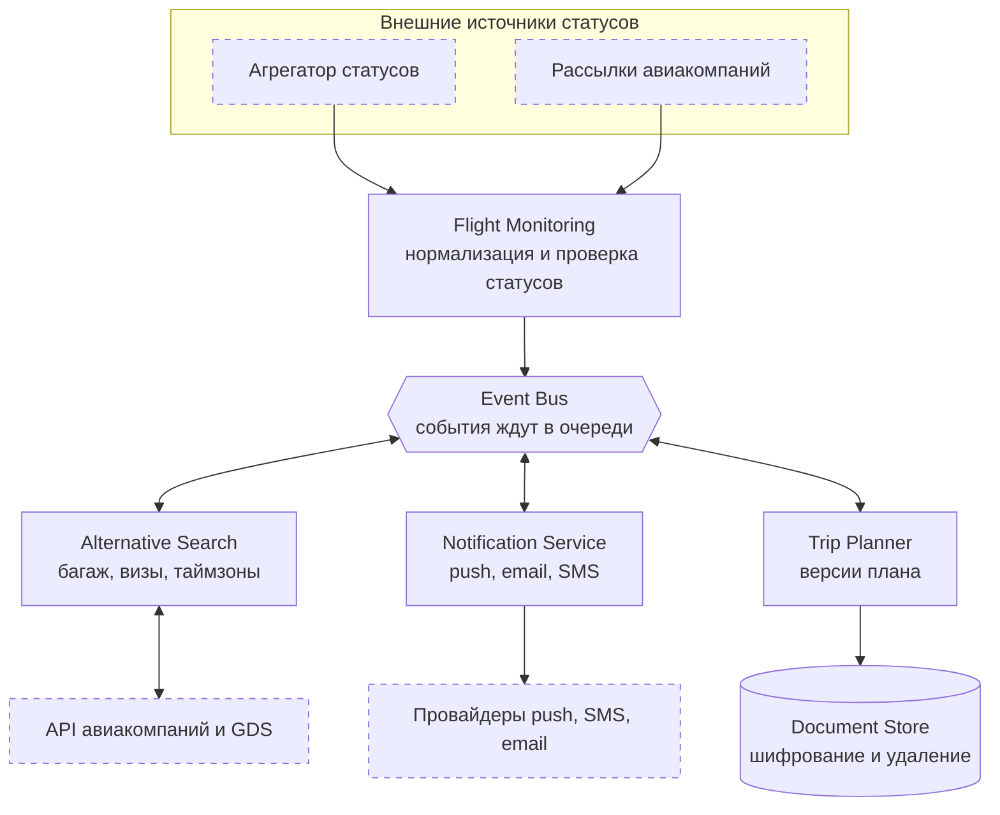

# 02. Архитектура

Сервисы обмениваются событиями через общую шину (например, Kafka). Если один сервис недоступен, события ждут в очереди и не теряются. Новых технологий и сервисов сверх этого не добавляем: задача аналитика показать границы ответственности и связи, а не подобрать стек.

Пунктиром обозначены внешние системы. Исходник диаграммы: [`diagrams/architecture.mmd`](../diagrams/architecture.mmd).

## Ответственность компонентов

| Компонент | Ответственность |
| --- | --- |
| Flight Monitoring | Получает статусы из источников, приводит их к единому формату, находит затронутые поездки |
| Event Bus | Передаёт события между сервисами, хранит их в очереди, пока сервис недоступен |
| Alternative Search | Ищет замену через API авиакомпаний и GDS, применяет проверки, выполняет перебронь |
| Notification Service | Отправляет push, email и SMS, отвечает за приоритеты, повторы и статус доставки |
| Trip Planner | Хранит версии общего плана, обновляет сегменты, следит за конфликтами изменений |
| Document Store | Хранит паспортные данные в зашифрованном виде и удаляет их по расписанию |

## Нормализация статусов

Разные источники называют одно и то же по-разному: отмену могут обозначать разными кодами и словами. Flight Monitoring приводит всё к единому набору статусов внутри системы (например, `SCHEDULED`, `DELAYED`, `CANCELLED`, `DIVERTED`). Отдельный сервис для этого не нужен.

## Основные события

| Событие | Кто публикует | Кто читает |
| --- | --- | --- |
| `FlightDelayed`, `FlightCancelled` | Flight Monitoring | Notification Service, Alternative Search |
| `AlternativesReady` | Alternative Search | Notification Service |
| `FlightRebooked` | Alternative Search | Trip Planner |
| `PlanUpdated` | Trip Planner | Notification Service |

## Почему событийная шина

- Сервисы не зависят друг от друга напрямую: сбой уведомлений не останавливает поиск альтернатив.
- Событие, пришедшее во время недоступности сервиса, не теряется и обрабатывается позже.
- Новый потребитель (например, аналитика) подключается без изменения существующих сервисов.

Цена этого решения: события могут приходить повторно и не по порядку. Правила защиты описаны в [05-exception-scenarios.md](05-exception-scenarios.md).
