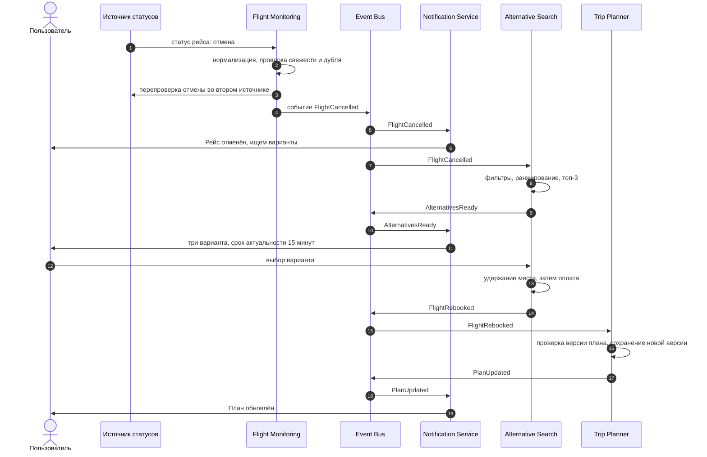
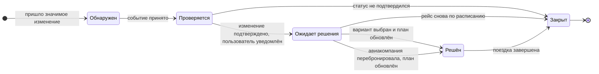

# 03. Бизнес-процесс: от задержки до нового плана

Первое уведомление уходит сразу, не дожидаясь подбора альтернатив. Билеты меняются только после явного выбора пользователя.

## Основной сценарий

Исходник: [`diagrams/sequence.mmd`](../diagrams/sequence.mmd).

## Шаги по порядку

1. **Пришло изменение статуса** от агрегатора, из рассылки или от GDS.
2. **Проверка: изменение значимое?** Если нет, только обновляем время в плане, без push.
3. **Найти затронутые поездки**: участники, стыковки, трансфер, отель.
4. **Сразу отправить первое уведомление**: «Рейс задержан на 2 ч, ищем варианты».
5. **Подобрать альтернативы** (правила в [05-exception-scenarios.md](05-exception-scenarios.md)). Если ждать больше 3 часов, дополнительно предложить зал ожидания, отель или другой город.
6. **Отправить варианты**, у каждого срок актуальности 15 минут.
7. **Проверка: вариант выбран?** Нет ответа: напоминание, затем SMS. Без согласия билеты не меняем.
8. **Перебронировать через шлюз**: сначала удержание места, затем оплата.
9. **Сохранить новую версию плана**: сдвинуть трансфер и отель, уведомить всех.

## Значимое изменение

Значимым считается:

- задержка более 15 минут;
- отмена;
- замена рейса или аэропорта;
- любая задержка, из-за которой ломается пересадка или трансфер.

Остальные изменения только обновляют время в плане, без push. Порог в 15 минут выбран для примера и настраивается.

## Ошибка перебронирования

Если удержание места или оплата не прошли, система снимает удержание, сообщает пользователю и возвращается к подбору: показывает следующие подходящие варианты без неудавшегося. Деньги списываются только после успешного удержания, поэтому повторного списания нет.

## Жизненный цикл инцидента

Каждая проблема с рейсом оформляется как инцидент, у которого есть состояние. Это защищает от повторного запуска процесса: если пользователь уже выбрал рейс, а через минуту приходит повторное сообщение об отмене, система видит, что инцидент решён, и не начинает всё заново.

Исходник: [`diagrams/state-machine.mmd`](../diagrams/state-machine.mmd).

| Состояние | Что означает |
| --- | --- |
| Обнаружен | Получена информация о задержке или отмене |
| Проверяется | Проверяется актуальность и достоверность статуса |
| Ожидает решения | Пользователю отправлены уведомление и варианты |
| Решён | Новый план подтверждён |
| Закрыт | Проблема больше не актуальна |
