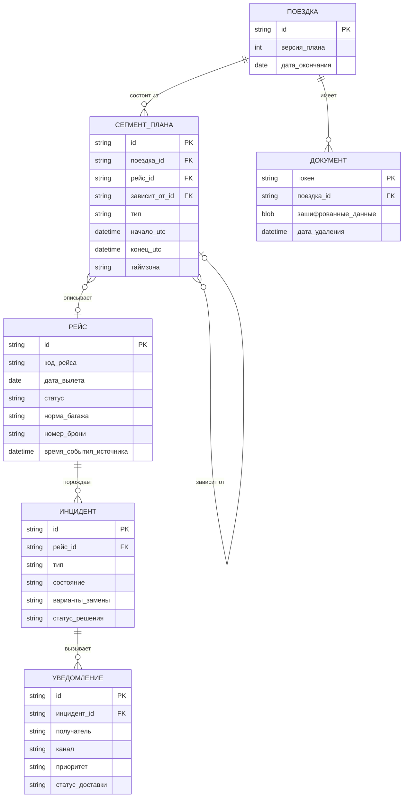

# 04. Модель данных

Шести сущностей хватает, чтобы хранить план, рейсы, инциденты, уведомления и документы. Названия даны по-русски, рядом указано техническое имя поля: так оно будет называться в базе и в API.

У каждой сущности есть идентификатор (`id`). Связи между сущностями хранятся внешними ключами, например `поездка_id` в сегменте плана.

## Поездка

| Поле | Техническое имя | Что хранит |
| --- | --- | --- |
| Участники | `participants` | Путешественники и организатор группы |
| Версия плана | `plan_version` | Номер версии общего плана: 1, 2, 3 |
| Дата окончания | `end_date` | Когда поездка заканчивается |

## Сегмент плана

Один пункт плана: рейс, отель, трансфер или активность.

| Поле | Техническое имя | Что хранит |
| --- | --- | --- |
| Тип | `segment_type` | Рейс, отель, трансфер, активность |
| Начало | `start_utc` | Время начала в UTC |
| Конец | `end_utc` | Время окончания в UTC |
| Таймзона | `timezone` | Таймзона места, для показа местного времени |
| От какого сегмента зависит | `depends_on_segment_id` | Например, трансфер зависит от рейса |

## Рейс

| Поле | Техническое имя | Что хранит |
| --- | --- | --- |
| Код рейса | `flight_code` | Номер рейса |
| Дата вылета | `departure_date` | День вылета |
| Статус | `status` | В расписании, задержан, отменён |
| Норма багажа | `baggage_allowance` | Что входит в билет |
| Номер брони | `booking_ref` | Код бронирования |
| Время события у источника | `source_updated_at` | Когда источник сформировал последнее сообщение |

## Инцидент

Проблема с рейсом: задержка или отмена.

| Поле | Техническое имя | Что хранит |
| --- | --- | --- |
| Рейс | `flight_id` | К какому рейсу относится |
| Тип | `incident_type` | Задержка или отмена |
| Состояние | `state` | Обнаружен, проверяется, ожидает решения, решён, закрыт |
| Варианты замены | `alternatives` | Предложенные альтернативные рейсы |
| Статус решения | `decision_status` | Выбрал ли пользователь вариант |

## Уведомление

| Поле | Техническое имя | Что хранит |
| --- | --- | --- |
| Получатель | `recipient` | Кому отправлено |
| Канал | `channel` | Push, email или SMS |
| Приоритет | `priority` | Обычное или критичное |
| Статус доставки | `delivery_status` | Ждёт отправки, доставлено, не доставлено |

## Документ

Паспортные данные, которые хранятся отдельно.

| Поле | Техническое имя | Что хранит |
| --- | --- | --- |
| Токен | `token` | Идентификатор, который передаётся другим сервисам вместо паспорта |
| Зашифрованные данные | `encrypted_data` | Сами данные документа в зашифрованном виде |
| Дата удаления | `delete_at` | Когда данные нужно удалить автоматически |

## Зачем нужны ключевые поля

- **Версия плана** (в Поездке): защищает от перезаписи чужих изменений, см. [05-exception-scenarios.md](05-exception-scenarios.md).
- **От какого сегмента зависит** (в Сегменте плана): так при сдвиге рейса система знает, какие трансфер и заселение нужно сдвинуть.
- **Время события у источника** (в Рейсе): позволяет не применять старые сообщения.
- **Состояние** (в Инциденте): не даёт запустить один и тот же процесс дважды.
- **Дата удаления** (в Документе): по ней паспортные данные удаляются автоматически.

## Хранение времени

Все времена хранятся в UTC вместе с таймзоной аэропорта. Сравнение рейсов и пересадок идёт только в UTC, пользователю показывается местное время аэропорта.
