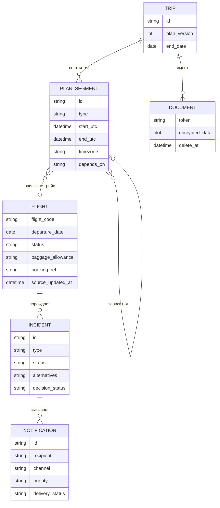

# 04. Модель данных

Шести сущностей хватает, чтобы хранить план, рейсы, инциденты, уведомления и документы.

## Сущности

| Сущность | Основные поля |
| --- | --- |
| Поездка | id, участники, версия плана, дата окончания |
| Сегмент плана | тип (рейс, отель, трансфер, активность), начало и конец в UTC, таймзона, от какого сегмента зависит |
| Рейс | код рейса, дата вылета, статус, норма багажа, номер брони, время события у источника |
| Инцидент | рейс, тип (задержка, отмена), состояние, варианты замены, статус решения |
| Уведомление | получатель, канал, приоритет, статус доставки |
| Документ | токен, зашифрованные данные, дата удаления |

## Зачем нужны ключевые поля

- **Версия плана** (в Поездке): защищает от перезаписи чужих изменений, см. [05-exception-scenarios.md](05-exception-scenarios.md).
- **От какого сегмента зависит** (в Сегменте плана): так при сдвиге рейса система знает, какие трансфер и заселение нужно сдвинуть.
- **Время события у источника** (в Рейсе): позволяет не применять старые сообщения.
- **Состояние** (в Инциденте): не даёт запустить один и тот же процесс дважды.
- **Дата удаления** (в Документе): по ней паспортные данные удаляются автоматически.

## Хранение времени

Все времена хранятся в UTC вместе с таймзоной аэропорта. Сравнение рейсов и пересадок идёт только в UTC, пользователю показывается местное время аэропорта.
